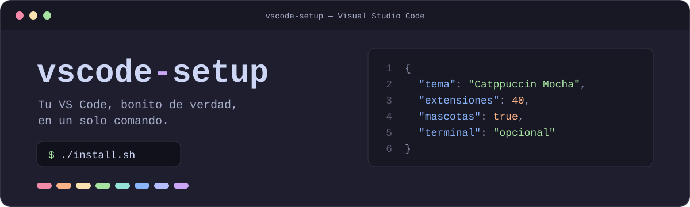
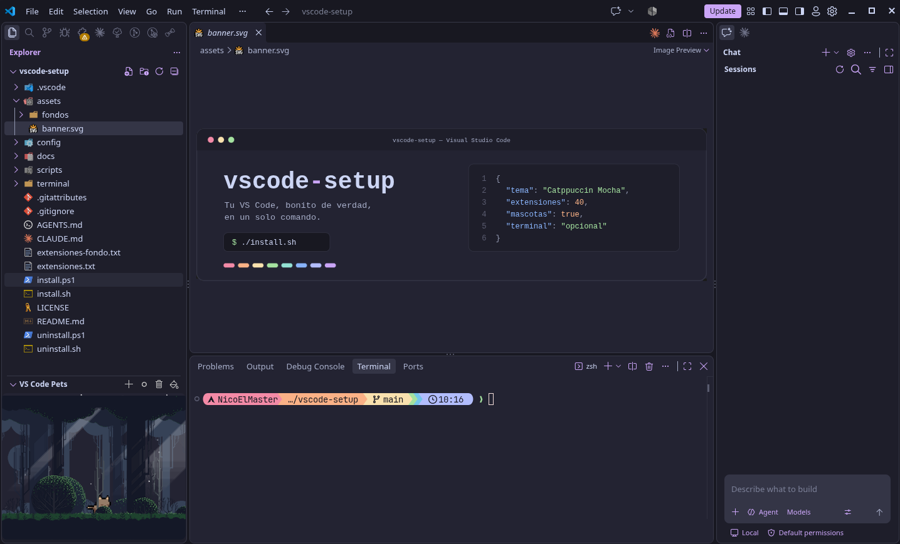

<div align="center">



<br><br>


</div>

# ¡Bienvenido a vscode-setup! 👋

Aquí está mi configuración visual de Visual Studio Code, lista para que la copies en unos minutos: el tema, los iconos, las ayudas de color, una mascota que camina por el editor y, si quieres, también la terminal y una imagen de fondo.

No cambia tu forma de programar ni instala nada para un lenguaje concreto: solo cambia cómo se ve el editor. Tampoco rompe lo que ya tienes. Tus ajustes se conservan, antes de tocar nada se guarda una copia, y todo se puede deshacer con un comando.

Puedes instalarla de tres formas: [pidiéndoselo a un agente de IA](#opción-1-que-lo-instale-un-agente-de-ia), [con el instalador](#opción-2-con-el-instalador) o [a mano, paso a paso](#opción-3-a-mano).

<!--
  Para mostrar una captura de pantalla, guárdala como assets/captura.png
  y saca la línea siguiente de este comentario:

  
-->

## ✨ Qué incluye

| | |
|---|---|
| 🎨 **Tema de color** | Catppuccin Mocha activo, y 13 temas más instalados para cambiar cuando quieras |
| 🗂️ **Iconos** | Un icono para cada tipo de archivo y carpeta, e iconos nuevos en toda la interfaz |
| 🌈 **Ayudas visuales** | Sangría de colores, errores escritos junto a la línea, colores CSS a la vista, comentarios resaltados |
| 🔤 **Fuente** | JetBrains Mono con ligaduras (`=>` y `!=` se ven como un solo símbolo) |
| 🐱 **Diversión** | Un gato que vive en el explorador de archivos y partículas al escribir |
| 🧭 **Diseño** | Barra de actividad arriba, buscador en la barra de título, animaciones suaves |
| 🖼️ **Fondo** *(opcional)* | Una imagen de fondo detrás del editor y la misma fuente en toda la interfaz |
| 💻 **Terminal** *(opcional)* | Prompt de Starship en bloques de colores, con `bat` y `eza` a juego |

La lista completa, con lo que hace cada extensión y cómo se usa, está en [docs/extensiones.md](docs/extensiones.md).

## 📋 Antes de empezar

Necesitas tres cosas:

1. **Visual Studio Code** con el comando `code` disponible. Compruébalo abriendo una terminal y escribiendo `code --version`. En Windows y Linux lo añade el propio instalador de VS Code; si no aparece, cierra la terminal y vuelve a abrirla. En macOS, abre VS Code, pulsa `Cmd+Shift+P` y ejecuta **Shell Command: Install 'code' command in PATH**.
2. **Git**, para descargar el repositorio. Si no lo tienes, usa el botón verde **Code → Download ZIP** de esta página y descomprime el archivo.
3. **La fuente JetBrainsMono Nerd Font.** Es recomendable pero no obligatoria: sin ella todo funciona, solo que no verás las ligaduras ni los iconos de la terminal.

| Sistema | Cómo instalar la fuente |
|---|---|
| Arch Linux | `sudo pacman -S ttf-jetbrains-mono-nerd` |
| macOS (Homebrew) | `brew install --cask font-jetbrains-mono-nerd-font` |
| Windows y otros | Descarga **JetBrainsMono** de [nerdfonts.com](https://www.nerdfonts.com/font-downloads), descomprime e instala los archivos `.ttf` |

En Linux y macOS el instalador usa además Python 3, que ya viene en casi todos los equipos.

## 🚀 Instalación

### Opción 1: que lo instale un agente de IA

Si usas un agente con acceso a la terminal (GitHub Copilot en modo agente, Claude Code, Cursor u otro), abre su chat y pega esto:

```text
Instala en mi VS Code la configuración de https://github.com/NicoElMaster/vscode-setup
Clona el repositorio en una carpeta que yo pueda conservar, lee su archivo AGENTS.md
y sigue esas instrucciones.
```

El agente encontrará en [AGENTS.md](AGENTS.md) todo lo que necesita. Revisará primero qué va a cambiar, instalará lo básico, te preguntará antes de tocar la terminal o el fondo, y al final te dirá qué hizo y qué te queda por hacer a ti.

### Opción 2: con el instalador

**Linux y macOS**

```bash
git clone https://github.com/NicoElMaster/vscode-setup.git
cd vscode-setup
./install.sh
```

**Windows** (en PowerShell)

```powershell
git clone https://github.com/NicoElMaster/vscode-setup.git
cd vscode-setup
powershell -ExecutionPolicy Bypass -File .\install.ps1
```

Eso instala lo básico: los ajustes visuales y las 38 extensiones. Se puede ejecutar las veces que quieras, porque solo hace lo que falte. Para elegir más o menos, añade una opción:

| Si quieres... | Linux y macOS | Windows |
|---|---|---|
| Ver qué haría, sin cambiar nada | `./install.sh --simular` | `.\install.ps1 -Simular` |
| Además, la terminal | `./install.sh --terminal` | no disponible |
| Además, el fondo y la fuente de la interfaz | `./install.sh --fondo` | `.\install.ps1 -Fondo` |
| El fondo con tu propia imagen | `./install.sh --imagen ~/foto.jpg` | `.\install.ps1 -Imagen C:\foto.jpg` |
| Todo | `./install.sh --todo` | `.\install.ps1 -Todo` |

En Windows, cada comando de la tabla se escribe con `powershell -ExecutionPolicy Bypass -File` delante, igual que en el ejemplo de arriba.

Antes de pedir el fondo, lee [docs/fondo-y-fuente.md](docs/fondo-y-fuente.md): es la única parte que modifica los archivos de VS Code y termina con un paso manual. La terminal está explicada en [docs/terminal.md](docs/terminal.md).

### Opción 3: a mano

Si prefieres ver y decidir cada cambio:

1. **Extensiones.** Abre la carpeta del repositorio en VS Code. En el panel de extensiones escribe `@recommended` y pulsa el icono de la nube (**Install Workspace Recommended Extensions**).
2. **Ajustes.** Pulsa `Ctrl+Shift+P`, ejecuta **Preferences: Open User Settings (JSON)** y copia dentro de las llaves el contenido de [config/settings.json](config/settings.json).
3. **Recarga.** Pulsa `Ctrl+Shift+P` y ejecuta **Developer: Reload Window**.

Cada paso, con sus alternativas y sus detalles, está en [docs/instalacion-manual.md](docs/instalacion-manual.md).

## 🎉 Después de instalar

En macOS, donde aquí dice `Ctrl` usa `Cmd`.

1. **Recarga la ventana**: `Ctrl+Shift+P` → **Developer: Reload Window**. Verás el tema oscuro y los iconos nuevos.
2. **Busca a tu mascota**: está en el explorador de archivos, abajo, en la sección **VS Code Pets**. Escribe `pet` en la paleta de comandos para añadir más animales o lanzarles una pelota.
3. **Prueba otros temas**: pulsa `Ctrl+K` y luego `Ctrl+T`, y muévete con las flechas para verlos en vivo.

## 🧩 Extensiones incluidas

<details>
<summary><b>Temas de color</b> (14)</summary>

Catppuccin, Tokyo Night, One Dark Pro, Dracula, Rosé Pine, Gruvbox, Nord, Night Owl, Ayu, Everforest, Kanagawa, GitHub Theme, Bearded Theme y SynthWave '84.
</details>

<details>
<summary><b>Iconos</b> (6)</summary>

Para archivos y carpetas: vscode-icons, Material Icon Theme, Catppuccin Icons y Symbols. Para la interfaz: Fluent Icons y Carbon.
</details>

<details>
<summary><b>Ayudas visuales en el código</b> (10)</summary>

Indent Rainbow, Error Lens, Better Comments, Color Highlight, Todo Tree, Highlight Matching Tag, Pretty TypeScript Errors, Image Preview, Rainbow CSV y Peacock.
</details>

<details>
<summary><b>Git, documentos y diagramas</b> (6)</summary>

GitLens, Git Graph, Markdown Preview Enhanced, Excalidraw, Draw.io y CodeSnap.
</details>

<details>
<summary><b>Diversión</b> (2)</summary>

VS Code Pets y Power Mode.
</details>

<details>
<summary><b>Fondo y fuente de la interfaz</b> (2, solo con <code>--fondo</code>)</summary>

Custom UI Style y Background. Modifican los archivos de VS Code, por eso van aparte.
</details>

## 🎨 Hazlo tuyo

Esto es un punto de partida. En [docs/personalizar.md](docs/personalizar.md) tienes cómo cambiar de mascota, apagar las partículas, mover la barra de actividad, usar otra fuente o preparar tu propia versión del repositorio.

| Para cambiar... | Haz esto |
|---|---|
| El tema de color | `Ctrl+K` y luego `Ctrl+T` |
| Los iconos de archivos | `Ctrl+Shift+P` → **Preferences: File Icon Theme** |
| Los iconos de la interfaz | `Ctrl+Shift+P` → **Preferences: Product Icon Theme** |
| La mascota | `Ctrl+Shift+P` → escribe `pet` |
| Las partículas al escribir | Ajuste `powermode.enabled` |

## ↩️ Volver atrás

```bash
./uninstall.sh                                             # Linux y macOS
powershell -ExecutionPolicy Bypass -File .\uninstall.ps1   # Windows
```

El desinstalador deshace solo lo que hizo el instalador. Cada ajuste vuelve al valor que tenía antes, y los que hayas cambiado tú después se quedan como los dejaste. Se desinstalan las extensiones que añadió el instalador, no las que ya tenías. Las copias de seguridad de tus ajustes no se borran.

## 📁 Qué hay en el repositorio

```text
vscode-setup/
├── install.sh / install.ps1       Instaladores (Linux y macOS / Windows)
├── uninstall.sh / uninstall.ps1   Desinstaladores
├── extensiones.txt                Las 38 extensiones de la instalación básica
├── extensiones-fondo.txt          Las 2 extensiones de la parte opcional de fondo
├── config/
│   ├── settings.json              Ajustes visuales de VS Code
│   └── settings-fondo.json        Ajustes del fondo y la fuente de la interfaz
├── terminal/                      Tema de Starship y configuración de bat
├── assets/                        Imagen de fondo y banner
├── scripts/                       Piezas internas de los instaladores
├── docs/                          Guías paso a paso
├── AGENTS.md                      Instrucciones para agentes de IA
└── .vscode/extensions.json        Recomendaciones para instalar desde VS Code
```

## 🛠️ ¿Algo no funciona?

Los problemas más comunes y su solución están en [docs/solucion-de-problemas.md](docs/solucion-de-problemas.md). Si el tuyo no aparece, [abre un issue](https://github.com/NicoElMaster/vscode-setup/issues) contando qué sistema usas y qué mensaje te salió.

## 🧪 Dónde se ha probado

Esta configuración nació en Arch Linux con KDE Plasma y VS Code 1.139. Los instaladores se probaron ahí, y además con bash 3.2 (el que trae macOS) y con PowerShell 7, pero todavía no en un Mac ni en un Windows reales. Si lo instalas en uno de ellos, cuéntame cómo te fue.

## 🙌 Créditos

Nada de esto existiría sin el trabajo de otras personas:

- [Catppuccin](https://catppuccin.com), por la paleta de colores que lo une todo.
- Los autores de cada una de las [40 extensiones](docs/extensiones.md).
- [Starship](https://starship.rs), por el prompt y su preajuste Catppuccin Powerline.
- Krystian Zajdel y la comunidad de KDE, por el fondo «Waterfall» (CC BY-SA 4.0). Detalles en [assets/fondos/CREDITOS.md](assets/fondos/CREDITOS.md).
- [JetBrains Mono](https://www.jetbrains.com/lp/mono/) y [Nerd Fonts](https://www.nerdfonts.com), por la fuente.

## 📄 Licencia

[MIT](LICENSE). Úsalo, cámbialo y compártelo. La imagen de fondo tiene su propia licencia, CC BY-SA 4.0.
